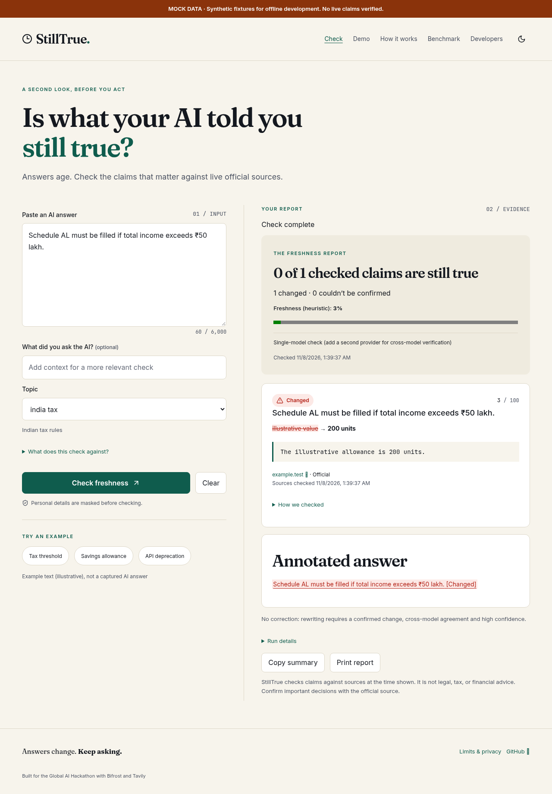
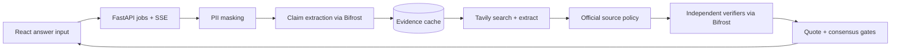

# StillTrue

**Check whether what your AI just told you is still true today, claim by claim, against live official sources.**

StillTrue is a freshness checker for actionable AI answers: thresholds, deadlines, fees, requirements and API versions. Paste an answer and receive **Still true**, **Changed**, or **Couldn't confirm**, with dated evidence and a transparent heuristic score. Built for the Global AI Hackathon (Geek Room), using Bifrost and Tavily; no endorsement is implied.

> Build status: runnable offline demonstration and implemented live integration. Live provider calls, a real captured demo and measured benchmark results require your credentials. Official domain activation is a separate required step described below. See [executed checks](docs/VERIFICATION.md). Do not submit mock output as real evidence.



## Start in five steps

1. Clone: `git clone https://github.com/hannielvinu/StillTrue.git && cd StillTrue`.
2. Copy configuration: `cp .env.example .env`. For an offline demonstration set `MOCK_MODE=true`. For live checking follow [credential setup](docs/KEYS.md), set model IDs and activate official source packs.
3. Start: `docker compose up --build -d`. The gateway has no provider access until you supply your own keys. In mock mode the app needs no external API.
4. Open the app at port **8000**, API docs at **/docs**, Bifrost at port **8080**. Check `/api/v1/health`: it reports gateway reachability and credential presence, not successful model inference. No live verification is claimed until a real check completes.
5. For development install Python 3.11+, uv, Node 22+ and run `make install`, then `MOCK_MODE=true make dev`. UI: **5173**, backend: **8000**, gateway: **8080**. Use a separate terminal for Docker Bifrost if running live. `make test lint build` runs the local CI checks.

No Git worktree is needed; each cloud task already has an isolated checkout. Dependencies are pinned in `backend/uv.lock` and `frontend/package-lock.json`. Do not commit `.env`, databases or generated builds.

## Features

- Default masking of common personal identifiers before outbound requests.
- Actionable-claim extraction with strict schemas and verbatim span validation.
- Tavily official-domain search, broader fallback search, then page extraction.
- Bifrost-only LLM access; independent verifier providers when configured.
- Deterministic official-source and copied-quote gates; ambiguity stays Unconfirmed.
- Concurrent claim checks, SSE progress, replay on reconnect, cancellation and partial results.
- SQLite evidence cache, volatility TTLs, persistent daily estimated credit reservations.
- Accessible light/dark interface, source links, annotated answers, copy/print, conditional corrections.
- Developer verified-chat endpoint, capture scripts, recording playback and real-only benchmark tooling.
- A permanent **MOCK DATA** banner and `mock: true` API flag in offline mode.

## Architecture



Bifrost uses its OpenAI-compatible chat endpoint, `x-bf-vk` virtual-key header when supplied, and provider keys via `env.NAME` references in `bifrost/config.json`. Request fallbacks are optional for extraction/rewriting/chat only. They are disabled for verification so fallback convergence cannot masquerade as independent agreement. Semantic caching is **off**: no vector database is provisioned; the SQLite cache stores retrieved evidence only. Gateway request-content logging is disabled in the supplied config. For reliable offline startup, Bifrost uses vendored upstream example catalog files through its documented file:// support; those limited snapshots are not current pricing data. No dollar costs are reported. Consult [upstream config docs](https://docs.getbifrost.ai/deployment-guides/config-json) and [fallback docs](https://docs.getbifrost.ai/features/retries-and-fallbacks).

Tavily uses raw async HTTP: advanced general-topic search (five results), an optional broader search, basic extraction of up to two official pages, bounded retries/timeouts and conservative credit reservations. Search dates and retrieval times do not prove a rule is in force. [Tavily docs](https://docs.tavily.com).

## Configuration

Environment is read from the process and `.env`. `MOCK_MODE` defaults to false. Only `.env.example` contains model defaults; application code contains no fixed model names.

| Variable | Purpose / default |
|---|---|
| APP_ENV | Deployment label, dev |
| MOCK_MODE | Explicit synthetic fixtures, false |
| BIFROST_BASE_URL | Gateway origin, localhost:8080 (Compose overrides to service name) |
| BIFROST_VIRTUAL_KEY | Optional gateway virtual key; never a provider key |
| TAVILY_API_KEY | Tavily credential, required live |
| OPENAI_API_KEY | Provider credential passed only to Bifrost |
| ANTHROPIC_API_KEY | Optional second-provider credential passed only to Bifrost |
| EXTRACTOR_MODEL | provider/model ID, set to an available model |
| VERIFIER_MODEL_A | First verifier provider/model ID |
| VERIFIER_MODEL_B | Optional independent provider/model; blank means single mode |
| FALLBACK_MODELS | Comma-separated provider/model IDs, optional; not used for verifiers |
| TAVILY_DAILY_CREDIT_CAP | Estimated reserved credits per UTC day, 200 |
| MAX_CLAIMS_PER_RUN | 8, maximum 20 |
| MAX_INPUT_CHARS | 6000 |
| CLAIM_CONCURRENCY | 4, maximum 8 |
| TAVILY_TIMEOUT_S | Per-attempt timeout, 20 seconds |
| LLM_TIMEOUT_S | Per-attempt timeout, 30 seconds |
| RATE_LIMIT | Per-client request limit, 20/minute |
| CACHE_TTL_HIGH_H | High-volatility evidence lifetime, 6 hours |
| CACHE_TTL_MED_H | Medium lifetime, 72 hours |
| CACHE_TTL_LOW_H | Low lifetime, 336 hours |
| CORS_ORIGINS | Comma-separated UI origins, localhost:5173 |
| CACHE_PATH | SQLite file, .data/evidence.db |
| FRONTEND_DIST | Optional built UI directory override |

Same-provider model IDs count as **single-model** mode; only one verifier runs. Two different provider prefixes enable cross-model mode. These are provider-family checks, not proof of independent training data.

## API examples

```bash
curl -X POST http://localhost:8000/api/v1/verify \
  -H 'Content-Type: application/json' \
  -d '{"text":"The annual ISA allowance is £20,000.","pack":"uk_personal_finance","redact":true}'
# Returns {job_id, mock}; then:
curl -N http://localhost:8000/api/v1/verify/JOB_ID/events
curl http://localhost:8000/api/v1/verify/JOB_ID
curl -X DELETE http://localhost:8000/api/v1/verify/JOB_ID
```

```python
import httpx
job = httpx.post("http://localhost:8000/api/v1/verify", json={
    "text": answer, "pack": "india_tax", "redact": True
}).json()
# Poll the job URL until status is complete; inspect result and error.
```

Verified chat: `POST /api/v1/chat/verified` with `{"messages":[{"role":"user","content":"Your question"}],"model":"provider/model","pack":"india_tax"}` returns `{answer, freshness, mock}`. This endpoint is not a drop-in OpenAI chat-completions endpoint. Point your OpenAI-compatible client at **Bifrost** (`base_url=http://localhost:8080/v1`), then call StillTrue to annotate the answer. Never point provider clients directly at a fabricated StillTrue OpenAI route.

Jobs are held in memory, expire after 30 minutes, and disappear on restart. SSE IDs support Last-Event-ID replay. In a multi-worker deployment add a shared job/event store; run one worker in this version.

## Domain packs

Edit `backend/app/packs/*.yaml`:

```yaml
name: my_pack
description: A narrowly scoped policy area
jurisdiction: Your jurisdiction
example_queries_hint: []
tier1_domains: [] # Add verified primary-source hostnames only
tier2_domains: []
blocked_domains: []
```

Use lowercase hostnames with no scheme/path; subdomains match on a dot boundary. Blocked domains are excluded from evidence. Tier 1 is required for a definitive verdict. Tier 2 is context only. General has no Tier 1 domains by design.

**Initial packs are conservative and have no activated domains** because official pages were blocked by cloud policy during the build. Run `backend/.venv/bin/python scripts/activate_packs.py` after allowing the domains, review its output, and rerun checks. It activates only hostnames whose official page returned success; inspect each source's relevance before relying on it. Until then live checks correctly remain Unconfirmed. See [decisions](docs/DECISIONS.md).

## Benchmark

<!-- benchmark:start -->
**Not yet run.** No measured accuracy, latency or cost claims are made.
<!-- benchmark:end -->

`benchmark/claims.jsonl` contains the one user-authorized human-verified seed. Additional candidates require opened official pages and human labels; no fabricated 40-row dataset is included. See [benchmark procedure](docs/BENCHMARK.md). Run `make bench` with real credentials; mock mode is refused. `python scripts/update_readme_results.py` inserts the latest actual report into this section.

Capture a genuine answer using `cd backend && .venv/bin/python ../scripts/capture_example.py 'Your question' --model provider/model`. Then `make record-demo CAPTURE=../examples/captured_TIMESTAMP.json`. Rebuild the frontend to include the recording. Until then `/demo` explicitly says no recording exists.

## Validation and submission

See [verification](docs/VERIFICATION.md), [architecture](docs/ARCHITECTURE.md), [scoring](docs/SCORING.md), [limitations](docs/LIMITATIONS.md), [demo script](docs/DEMO_SCRIPT.md), [pitch](docs/PITCH.md) and [submission copy](docs/SUBMISSION.md). Use `make test`, `make lint`, `make build`, `make up`, `make bench`, `make record-demo`. CI uses the same local checks and advisory dependency audits; a written workflow is not a claimed remote CI pass.

## Privacy and limitations

This is not professional advice. PII detection is best-effort. Do not paste secrets. Claim text and evidence go to your configured LLM providers through Bifrost; derived search queries and official URLs go to Tavily. Answers remain in temporary in-memory jobs for up to 30 minutes; disk storage contains retrieved evidence and budget counters. Upstream retention policies still apply. Official sources may be stale or ambiguous and models can still err. No calibrated probability, complete source coverage or independent model training is claimed. No external authentication is included: bind locally or put an authenticated reverse proxy in front before public deployment.

## Stack and license

Python 3.11+, FastAPI, Pydantic v2, httpx, aiosqlite, PyYAML, slowapi; React 18, strict TypeScript, Vite, Tailwind 3.4, Lucide, self-hosted Fraunces/Inter/JetBrains Mono fonts. Docker Compose and GitHub Actions. MIT, copyright 2026 Hanniel Vinu.

An AI coding assistant helped implement and test this project. Human review is still required before submission; this README does not claim that review has happened.

## Pitch presentation

[Download the editable PowerPoint](docs/presentation/StillTrue_Pitch.pptx) · [Read the PDF](docs/presentation/StillTrue_Pitch.pdf). Eight slides with speaker notes; mock output and live-validation prerequisites are labelled.
