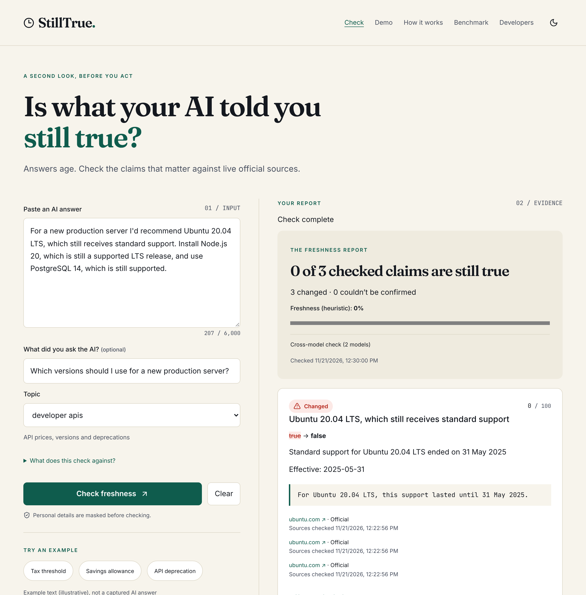
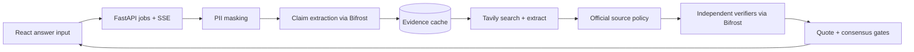

# StillTrue

**Check whether what your AI just told you is still true today, claim by claim, against live official sources.**

StillTrue is a freshness checker for actionable AI answers: thresholds, deadlines, fees, requirements and API versions. Paste an answer and receive **Still true**, **Changed**, or **Couldn't confirm**, with dated evidence and a transparent heuristic score. Built for the Global AI Hackathon (Geek Room), using Bifrost and Tavily; no endorsement is implied.

> **Live and measured (21 Nov 2026).** Real Tavily search + extract, real Bifrost gateway (v2.4.0), two independent verifier models on two providers. On 28 claims labelled against official pages, StillTrue was right **22/28 (79%)** vs **17/28 (61%)** for the same model answering alone, and **6/7 vs 0/7 on facts newer than the model's training**. When it gives a verdict it was right **22 of 23 times**. [Full results](#benchmark).



*Real live run in the app: an AI-style answer recommending Ubuntu 20.04, Node.js 20 and PostgreSQL 14. All three are flagged **Changed**, each with a verbatim quote from the publisher (ubuntu.com, nodejs.org, postgresql.org: "November 12, 2026").*

## Why it matters

AI answers age silently. A model trained last year will tell you Node.js 20 is the LTS to use, a visa costs £115, or that a version you have never heard of "does not exist". The answer reads confidently; nothing says it is out of date. StillTrue reads the answer, pulls out the claims you would act on (prices, versions, deadlines, thresholds), and checks each one **today** against the organisation that actually publishes the fact.

## What makes it different

1. **The publisher of the fact is the authority.** For each claim the extractor names the official source (openai.com for OpenAI prices, python.org for Python support, gov.uk for UK fees); Tavily searches that domain first. Government domains count as official everywhere; wikis, blogs and aggregators never do.
2. **No quote, no verdict.** A verdict needs a quote of at most 25 words found word-for-word on an official page. If a model paraphrases, it gets one chance to copy the exact text; otherwise the claim stays *Couldn't confirm*.
3. **Two independent models must agree.** Verifier A (Groq `gpt-oss-120b`) and verifier B (NVIDIA `nemotron-3.5-lightning`) judge separately through Bifrost; any conflict on the current value blocks the verdict. Fallbacks are disabled for verifiers so a fallback can never fake agreement.
4. **Built for free tiers.** Evidence cache, per-call token ledger, Retry-After handling and low reasoning effort: the full 28-claim benchmark cost about 2.6 Tavily credits per claim.

## Start in five steps

1. Clone: `git clone https://github.com/hannielvinu/StillTrue.git && cd StillTrue`.
2. Copy configuration: `cp .env.example .env` and fill `TAVILY_API_KEY`, `GROQ_API_KEY` and `NVIDIA_API_KEY` (all have free tiers; see [credential setup](docs/KEYS.md)). The model IDs in `.env.example` are the ones used for the benchmark. For a key-free UI tour set `MOCK_MODE=true`.
3. Start: `docker compose up --build -d`. The gateway has no provider access until you supply your own keys. In mock mode the app needs no external API.
4. Open the app at port **8000**, API docs at **/docs**, Bifrost at port **8080**. Check `/api/v1/health` (gateway reachability and credentials), then paste an answer in the UI or run `make bench` to reproduce the benchmark.
5. For development install Python 3.11+, uv, Node 22+ and run `make install`, then `MOCK_MODE=true make dev`. UI: **5173**, backend: **8000**, gateway: **8080**. Use a separate terminal for Docker Bifrost if running live. `make test lint build` runs the local CI checks.

Dependencies are pinned in `backend/uv.lock` and `frontend/package-lock.json`. Do not commit `.env`, databases or generated builds.

## Features

- Default masking of common personal identifiers before outbound requests.
- Actionable-claim extraction with strict schemas and verbatim span validation.
- Tavily official-domain search, broader fallback search, then page extraction.
- Bifrost-only LLM access; independent verifier providers when configured.
- Deterministic official-source and copied-quote gates; ambiguity stays Unconfirmed.
- Concurrent claim checks, SSE progress, replay on reconnect, cancellation and partial results.
- SQLite evidence cache, volatility TTLs, persistent daily estimated credit reservations.
- Accessible light/dark interface, source links, annotated answers, copy/print, conditional corrections.
- Developer verified-chat endpoint, capture scripts, recording playback and real-only benchmark tooling.
- A permanent **MOCK DATA** banner and `mock: true` API flag in offline mode.

## Architecture



Bifrost uses its OpenAI-compatible chat endpoint, `x-bf-vk` virtual-key header when supplied, and provider keys via `env.NAME` references in `bifrost/config.json`. Request fallbacks are optional for extraction/rewriting/chat only. They are disabled for verification so fallback convergence cannot masquerade as independent agreement. Semantic caching is **off**: no vector database is provisioned; the SQLite cache stores retrieved evidence only. Gateway request-content logging is disabled in the supplied config. For reliable offline startup, Bifrost uses vendored upstream example catalog files through its documented file:// support; those limited snapshots are not current pricing data. No dollar costs are reported. Consult [upstream config docs](https://docs.getbifrost.ai/deployment-guides/config-json) and [fallback docs](https://docs.getbifrost.ai/features/retries-and-fallbacks).

Tavily uses raw async HTTP: advanced general-topic search (five results), an optional broader search, basic extraction of up to two official pages, bounded retries/timeouts and conservative credit reservations. Search dates and retrieval times do not prove a rule is in force. [Tavily docs](https://docs.tavily.com).

## Configuration

Environment is read from the process and `.env`. `MOCK_MODE` defaults to false. Only `.env.example` contains model defaults; application code contains no fixed model names.

| Variable | Purpose / default |
|---|---|
| APP_ENV | Deployment label, dev |
| MOCK_MODE | Explicit synthetic fixtures, false |
| BIFROST_BASE_URL | Gateway origin, localhost:8080 (Compose overrides to service name) |
| BIFROST_VIRTUAL_KEY | Optional gateway virtual key; never a provider key |
| TAVILY_API_KEY | Tavily credential, required live |
| OPENAI_API_KEY | Provider credential passed only to Bifrost |
| ANTHROPIC_API_KEY | Optional second-provider credential passed only to Bifrost |
| EXTRACTOR_MODEL | provider/model ID, set to an available model |
| VERIFIER_MODEL_A | First verifier provider/model ID |
| VERIFIER_MODEL_B | Optional independent provider/model; blank means single mode |
| FALLBACK_MODELS | Comma-separated provider/model IDs, optional; not used for verifiers |
| TAVILY_DAILY_CREDIT_CAP | Estimated reserved credits per UTC day, 200 |
| MAX_CLAIMS_PER_RUN | 8, maximum 20 |
| MAX_INPUT_CHARS | 6000 |
| CLAIM_CONCURRENCY | 4, maximum 8 |
| TAVILY_TIMEOUT_S | Per-attempt timeout, 20 seconds |
| LLM_TIMEOUT_S | Per-attempt timeout, 30 seconds |
| RATE_LIMIT | Per-client request limit, 20/minute |
| CACHE_TTL_HIGH_H | High-volatility evidence lifetime, 6 hours |
| CACHE_TTL_MED_H | Medium lifetime, 72 hours |
| CACHE_TTL_LOW_H | Low lifetime, 336 hours |
| CORS_ORIGINS | Comma-separated UI origins, localhost:5173 |
| CACHE_PATH | SQLite file, .data/evidence.db |
| FRONTEND_DIST | Optional built UI directory override |

Same-provider model IDs count as **single-model** mode; only one verifier runs. Two different provider prefixes enable cross-model mode. These are provider-family checks, not proof of independent training data.

## API examples

```bash
curl -X POST http://localhost:8000/api/v1/verify \
  -H 'Content-Type: application/json' \
  -d '{"text":"The annual ISA allowance is £20,000.","pack":"uk_personal_finance","redact":true}'
# Returns {job_id, mock}; then:
curl -N http://localhost:8000/api/v1/verify/JOB_ID/events
curl http://localhost:8000/api/v1/verify/JOB_ID
curl -X DELETE http://localhost:8000/api/v1/verify/JOB_ID
```

```python
import httpx
job = httpx.post("http://localhost:8000/api/v1/verify", json={
    "text": answer, "pack": "india_tax", "redact": True
}).json()
# Poll the job URL until status is complete; inspect result and error.
```

Verified chat: `POST /api/v1/chat/verified` with `{"messages":[{"role":"user","content":"Your question"}],"model":"provider/model","pack":"india_tax"}` returns `{answer, freshness, mock}`. This endpoint is not a drop-in OpenAI chat-completions endpoint. Point your OpenAI-compatible client at **Bifrost** (`base_url=http://localhost:8080/v1`), then call StillTrue to annotate the answer. Never point provider clients directly at a fabricated StillTrue OpenAI route.

Jobs are held in memory, expire after 30 minutes, and disappear on restart. SSE IDs support Last-Event-ID replay. In a multi-worker deployment add a shared job/event store; run one worker in this version.

## Domain packs

Edit `backend/app/packs/*.yaml`:

```yaml
name: my_pack
description: A narrowly scoped policy area
jurisdiction: Your jurisdiction
example_queries_hint: []
tier1_domains: [] # Add verified primary-source hostnames only
tier2_domains: []
blocked_domains: []
```

Use lowercase hostnames with no scheme/path; subdomains match on a dot boundary. Blocked domains are excluded from evidence. Tier 1 is required for a definitive verdict. Tier 2 is context only. General has no Tier 1 domains by design.

Every pack also accepts **the publisher of each fact** (named per claim by the extractor and validated: no wikis, blogs, forums or aggregators) and **government domains** (.gov, .gov.in, .gov.uk, europa.eu, …) as official. Curated lists ship for developer APIs (vendor docs), India tax (incometax.gov.in, cbic-gst.gov.in, RBI, SEBI…), UK personal finance (gov.uk, FCA) and travel/visa (travel.state.gov, uscis.gov, gov.uk, canada.ca…). Set `allow_publisher_domain: false` or `allow_government: false` in a pack to restrict it to its own list.

## Benchmark

<!-- benchmark:start -->
**Run on 21 Nov 2026** · 28 claims · live Tavily + Bifrost · raw report: [`benchmark/results/20261121T122711.json`](benchmark/results/20261121T122711.json)

| | StillTrue | Same model alone (no search) |
|---|---|---|
| Correct verdicts | **22 / 28 (79%)** | 17 / 28 (61%) |
| Facts newer than the model's training (7) | **6 / 7** | 0 / 7 (called all of them outdated) |
| Older facts (21) | 16 / 21 | 17 / 21 |
| Right when it commits to a verdict | **22 / 23 (96%)** | 17 / 25 (68%) |
| Said "Couldn't confirm" | 5 | 3 |
| Median time per claim | 18.6 s | 0.6 s |

Models through Bifrost: extractor `groq/openai/gpt-oss-20b`; verifiers `groq/openai/gpt-oss-120b` + `nvidia/nvidia/nemotron-3.5-lightning-30b-a3b`. Baseline: `gpt-oss-120b` asked "is this still true today?" with no retrieval. Mean 2.57 estimated Tavily credits per claim.

**Dataset.** 28 claims (14 still true, 14 changed): software support status (Python, Node.js, PHP, PostgreSQL, Go, Ubuntu, Kubernetes), UK allowances and visa fees, and one India tax threshold. Every label was checked by hand against the official page on the day of the run (`benchmark/claims.jsonl` records the page and value). It is small and skewed toward software lifecycles; treat it as a sanity check, not a leaderboard.

**Where it failed, honestly.** The one wrong verdict: an official incometax.gov.in help page still says Schedule AL applies above ₹50 lakh, while the label (from incometaxindia.gov.in) says ₹1 crore. StillTrue trusted the stale government page and showed its quote. Official sources can disagree; detecting that conflict is the next feature. The five *Couldn't confirm* results: three still-true claims where the models' quotes did not match the official page word for word (the quote gate held), one changed claim (Go 1.24) where the two verifiers disagreed, and one provider error (Node.js 22), counted as a miss rather than retried.
<!-- benchmark:end -->

Capture a genuine answer using `cd backend && .venv/bin/python ../scripts/capture_example.py 'Your question' --model provider/model`. Then `make record-demo CAPTURE=../examples/captured_TIMESTAMP.json`. Rebuild the frontend to include the recording. Until then `/demo` explicitly says no recording exists.

## Validation and submission

See [verification](docs/VERIFICATION.md), [architecture](docs/ARCHITECTURE.md), [scoring](docs/SCORING.md), [limitations](docs/LIMITATIONS.md), [demo script](docs/DEMO_SCRIPT.md), [pitch](docs/PITCH.md) and [submission copy](docs/SUBMISSION.md). Use `make test`, `make lint`, `make build`, `make up`, `make bench`, `make record-demo`. CI uses the same local checks and advisory dependency audits; a written workflow is not a claimed remote CI pass.

## Privacy and limitations

This is not professional advice. PII detection is best-effort. Do not paste secrets. Claim text and evidence go to your configured LLM providers through Bifrost; derived search queries and official URLs go to Tavily. Answers remain in temporary in-memory jobs for up to 30 minutes; disk storage contains retrieved evidence and budget counters. Upstream retention policies still apply. Official sources may be stale or ambiguous and models can still err. No calibrated probability, complete source coverage or independent model training is claimed. No external authentication is included: bind locally or put an authenticated reverse proxy in front before public deployment.

## Stack and license

Bifrost (Maxim AI) gateway, Tavily search/extract, Groq and NVIDIA model APIs, Python 3.11+, FastAPI, Pydantic v2, httpx, aiosqlite, PyYAML, slowapi; React 18, strict TypeScript, Vite, Tailwind 3.4, Lucide, self-hosted Fraunces/Inter/JetBrains Mono fonts. Docker Compose and GitHub Actions. MIT, copyright 2026 Hanniel Vinu.

**AI use (disclosed per the hackathon rules):** StillTrue uses LLMs through Bifrost for claim extraction, verification and the corrected answer, and Tavily for live search. An AI coding assistant helped build and test the code.

## Pitch deck and demo

- Demo video (99 s, narrated walkthrough of a recorded real run): [`docs/demo/StillTrue_demo.mp4`](docs/demo/StillTrue_demo.mp4)
- Pitch deck: [PDF](deck/StillTrue_Pitch.pdf) · [PPTX](deck/StillTrue_Pitch.pptx), with the measured benchmark and the live screenshot above.
- Live run screenshots: [`docs/screenshots/live-input-1280.png`](docs/screenshots/live-input-1280.png), [`docs/screenshots/live-result-1280.png`](docs/screenshots/live-result-1280.png).
- A key-free offline build (`VITE_OFFLINE_DEMO=true npm run build`) exists for browsing the UI without credentials; it is labelled **MOCK DATA** and never shows a verdict.
